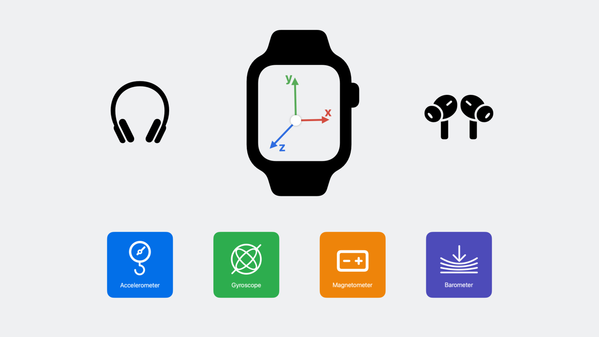

# Core Motion

**Core Motion** คือ framework ที่อ่านข้อมูลการเคลื่อนไหวของเครื่อง เช่น เครื่องถูกเขย่า เอียง หมุน หรือกำลังขึ้นบันได ข้อมูลนี้เป็นพื้นฐานของ app ออกกำลังกาย เกม และการจดจำท่าทาง ใช้ได้ทั้ง Xcode 26 และ 27

## Sensor มีอะไรบ้าง

| Sensor | วัดอะไร | หน่วย |
|---|---|---|
| **Accelerometer** | ความเร่งของเครื่อง รวมแรงโน้มถ่วง | g (1 g ≈ 9.8 m/s²) |
| **Gyroscope** | ความเร็วในการหมุนรอบแกน x, y, z | radian ต่อวินาที |
| **Magnetometer** | สนามแม่เหล็ก ใช้หาทิศ | microtesla |
| **Barometer** | ความกดอากาศ ใช้หาความสูงที่เปลี่ยนไป | kPa, เมตร |

ค่าดิบจาก sensor แต่ละตัวมี noise และปนกันอยู่ เช่น accelerometer วัดได้ทั้งแรงโน้มถ่วงและการขยับมือรวมกัน Core Motion จึงมี **device motion** ที่รวมข้อมูลหลาย sensor แล้วแยกออกมาให้ใช้ง่าย แนะนำให้ใช้ตัวนี้

| ค่าใน `CMDeviceMotion` | ความหมาย | ใช้ทำอะไร |
|---|---|---|
| `userAcceleration` | ความเร่งที่ผู้ใช้ทำ (ตัดแรงโน้มถ่วงออกแล้ว) | ตรวจจับการเขย่า การกระแทก การเหวี่ยง |
| `gravity` | ทิศของแรงโน้มถ่วงเทียบกับเครื่อง ([อธิบาย](#gravity)) | รู้ว่าเครื่องตั้ง นอน หรือคว่ำอยู่ |
| `rotationRate` | ความเร็วการหมุน (ปรับเทียบแล้ว) ([อธิบาย](#rotation-rate)) | ตรวจจับการบิด การหมุนข้อมือ |
| `attitude` | มุมของเครื่อง: `pitch`, `roll`, `yaw` ([อธิบาย](#attitude)) | ตรวจจับการเอียง ใช้เป็นจอยควบคุม |


*ภาพจาก [WWDC23 session 10179](https://developer.apple.com/videos/play/wwdc2023/10179/)*

## อ่านข้อมูลการเคลื่อนไหว

* สร้าง `CMMotionManager` **ตัวเดียว** ทั้ง app เพื่อ Check ว่าเครื่องรองรับ
* ตั้ง sampling rate แล้วเริ่มรับข้อมูล Core Motion จะเรียก closure ทุกครั้งที่มีค่าใหม่

```swift
import CoreMotion

let motion = CMMotionManager()

func startMotionUpdates(onSample: @escaping (CMDeviceMotion) -> Void) {
    guard motion.isDeviceMotionAvailable else { return }   // Simulator ไม่มี sensor
    motion.deviceMotionUpdateInterval = 1.0 / 50.0         // 50 ครั้งต่อวินาที (50 Hz)
    motion.startDeviceMotionUpdates(to: .main) { data, _ in
        if let data { onSample(data) }
    }
}

func stopMotionUpdates() {
    motion.stopDeviceMotionUpdates()
}
```

ตัวอย่างการใช้ใน SwiftUI: เริ่มเมื่อหน้าจอแสดง และ **หยุดเมื่อออกจากหน้าจอ** เพราะ sensor ที่เปิดค้างไว้กินแบตเตอรี่ตลอดเวลา

```swift
struct MotionView: View {
    @State private var x = 0.0

    var body: some View {
        Text("แรงเหวี่ยงแกน x: \(x, specifier: "%.2f") g")
            .onAppear {
                startMotionUpdates { data in
                    x = data.userAcceleration.x
                }
            }
            .onDisappear { stopMotionUpdates() }
    }
}
```

!!! note "ต้องทดสอบบนเครื่องจริง (iPad หรือ iPhone)"
    Simulator ไม่มี sensor การเคลื่อนไหว `isDeviceMotionAvailable` จะเป็น `false`

## มุมของเครื่อง: roll, pitch, yaw { #attitude }

`attitude` บอกว่า **ตอนนี้เครื่องเอียงอยู่แค่ไหน** แยกเป็น 3 มุม ขยับได้ 3 แบบ

| มุม | ลองทำกับ iPad ที่วางราบบนโต๊ะ (แนวตั้ง จอหันขึ้น) | หมุนรอบแกน | ช่วงค่า |
|---|---|---|---|
| **pitch** | ยกขอบบนขึ้น หรือกดขอบบนลง | x | -90° ถึง 90° |
| **roll** | ยกขอบขวาหรือขอบซ้ายขึ้น | y | -180° ถึง 180° |
| **yaw** | หมุนเครื่องบนโต๊ะ โดยไม่ยกขึ้น | z | -180° ถึง 180° |

### Radian กับองศา

Core Motion ให้มุมเป็น **radian** ไม่ใช่องศา แปลงเป็นองศาด้วย `radian * 180 / .pi`

| Radian | องศา | ความหมาย |
|---|---|---|
| `0` | 0° | วางราบ ไม่เอียง |
| `.pi / 4` | 45° | เอียงครึ่งทาง (ค่านี้ใช้ใน [`detectGesture`](#gesture)) |
| `.pi / 2` | 90° | ตั้งขึ้นตรง |

### ดูค่าทั้ง 3 มุม

ใช้ `startMotionUpdates` เหมือน `MotionView` แค่เปลี่ยนไปอ่าน `data.attitude` แล้วลองขยับเครื่องตามตารางด้านบนดูว่ามุมไหนเปลี่ยน

```swift
struct AttitudeView: View {
    @State private var pitch = 0.0
    @State private var roll = 0.0
    @State private var yaw = 0.0

    var body: some View {
        VStack {
            Text("pitch: \(pitch, specifier: "%.0f")°")
            Text("roll: \(roll, specifier: "%.0f")°")
            Text("yaw: \(yaw, specifier: "%.0f")°")
        }
        .onAppear {
            startMotionUpdates { data in
                pitch = data.attitude.pitch * 180 / .pi  // radian → องศา
                roll = data.attitude.roll * 180 / .pi
                yaw = data.attitude.yaw * 180 / .pi
            }
        }
        .onDisappear { stopMotionUpdates() }
    }
}
```

### เอียงหรือไม่เอียง?

วาง iPad ราบบนโต๊ะหรือชั้นวาง ถ้า roll ใกล้ 0° แปลว่าพื้นไม่เอียงซ้ายขวา เส้นบนจอหมุนตามมุมเอียง และเปลี่ยนเป็นสีเขียวเมื่อตรงแล้ว

```swift
struct LevelView: View {
    @State private var roll = 0.0  // มุมเอียงซ้าย-ขวา (radian)

    var body: some View {
        let degrees = roll * 180 / .pi
        let isLevel = abs(degrees) < 1  // เอียงไม่ถึง 1° ถือว่าตรง

        VStack(spacing: 40) {
            Text(String(format: "%.1f°", degrees))
                .font(.system(size: 80, weight: .bold))

            Capsule() // เส้นหมุนตามมุมเอียงของเครื่อง
                .fill(isLevel ? .green : .orange)
                .frame(width: 300, height: 12)
                .rotationEffect(.radians(-roll))

            Text(isLevel ? "ตรงแล้ว" : "ยังเอียงอยู่")
        }
        .onAppear {
            startMotionUpdates { data in
                roll = data.attitude.roll
            }
        }
        .onDisappear { stopMotionUpdates() }
    }
}
```

ลองเพิ่มเอง: อ่าน `pitch` ด้วย แล้วเช็กว่าโต๊ะเอียงหน้าหลังไหม

!!! warning "yaw ไม่ใช่ทิศเหนือ"
    yaw = 0° คือทิศที่เครื่องหันอยู่ **ตอนเริ่ม** `startMotionUpdates` ไม่ใช่ทิศเหนือ ถ้าต้องการทิศจริงแบบเข็มทิศต้องใช้ magnetometer ซึ่งไม่อยู่ใน workshop นี้

## gravity: เครื่องอยู่ในท่าไหน { #gravity }

แรงโน้มถ่วงชี้ลงพื้นเสมอ `gravity` บอกว่าทิศนั้นอยู่ตรงไหนเทียบกับแกนของเครื่อง หน่วยเป็น g แกนที่ชี้ลงพื้นจะมีค่าใกล้ ±1 แกนอื่นใกล้ 0

| ท่าของเครื่อง | x | y | z |
|---|---|---|---|
| วางราบบนโต๊ะ จอหงายขึ้น | 0 | 0 | **-1** |
| คว่ำจอลงโต๊ะ | 0 | 0 | **+1** |
| ตั้งแนวตั้งตรงหน้า | 0 | **-1** | 0 |
| ตั้งแนวนอน | **±1** | 0 | 0 |

ค่าดิบจาก accelerometer คือ `gravity` + `userAcceleration` รวมกัน Core Motion แยกให้แล้ว จึงใช้ `gravity` บอก **ท่าของเครื่อง** และใช้ `userAcceleration` บอก **การขยับ** ขยับเครื่องเร็ว ๆ `gravity` แทบไม่เปลี่ยน

```swift
startMotionUpdates { data in
    x = data.gravity.x
    y = data.gravity.y
    z = data.gravity.z
}
```

`gravity` กับ `attitude` บอกท่าของเครื่องเหมือนกัน `gravity` เช็กง่ายกว่าเมื่อต้องการรู้แค่ว่าวางท่าไหน เช่น คว่ำหรือหงาย ส่วน `attitude` เหมาะเมื่อต้องการมุมเป็นองศา

## rotationRate: หมุนเร็วแค่ไหน { #rotation-rate }

`rotationRate` บอก **ความเร็ว** การหมุนรอบแต่ละแกน หน่วยเป็น radian ต่อวินาที ไม่ใช่มุม หยุดหมุนเมื่อไหร่ค่ากลับเป็น 0 ทันที แม้เครื่องจะเอียงค้างอยู่

| แกน | ลองทำกับเครื่องที่วางราบบนโต๊ะ | มุมที่เปลี่ยนใน `attitude` |
|---|---|---|
| x | ยกขอบบนขึ้นหรือกดลง | pitch |
| y | ยกขอบซ้ายหรือขวาขึ้น | roll |
| z | หมุนเครื่องบนโต๊ะ | yaw |

หมุนครบ 1 รอบคือ 2π ≈ 6.3 radian ถ้าหมุนครบรอบใน 1 วินาที ค่าจะได้ราว 6.3 rad/s

```swift
startMotionUpdates { data in
    x = data.rotationRate.x
    y = data.rotationRate.y
    z = data.rotationRate.z
}
```

ใช้ `attitude` เมื่อสนใจว่า **ตอนนี้เอียงอยู่เท่าไหร่** และใช้ `rotationRate` เมื่อสนใจว่า **เพิ่งหมุนเร็วแค่ไหน** เช่น ตวัดหรือบิดข้อมือ

## เลือก sampling rate

Sampling rate คือจำนวนครั้งที่อ่านค่าต่อวินาที ยิ่งสูงยิ่งเห็นการเคลื่อนไหวละเอียด แต่กินแบตเตอรี่และ CPU มากขึ้น

| Rate | `deviceMotionUpdateInterval` | เหมาะกับ |
|---|---|---|
| 10 Hz | `1.0 / 10.0` | ท่าช้า ๆ เช่น เอียงเครื่อง, ท่าทางของร่างกาย |
| 50 Hz | `1.0 / 50.0` | การเคลื่อนไหวทั่วไป เช่น ตรวจจับการเขย่า, เกมเอียงเครื่อง |
| 100 Hz | `1.0 / 100.0` | การเคลื่อนไหวเร็วมาก เช่น เหวี่ยงไม้ ตีลูก |

## ตรวจจับท่าแบบง่ายโดยไม่ใช้ ML { #gesture }

ท่าง่าย ๆ ไม่ต้อง train model ก็ได้ ใช้ค่าจาก device motion ตั้งเงื่อนไขเอง

```swift
func detectGesture(_ data: CMDeviceMotion) -> String? {
    let a = data.userAcceleration
    let force = (a.x * a.x + a.y * a.y + a.z * a.z).squareRoot()

    if force > 2.0 { return "เขย่า" } // แรงลัพธ์เกิน 2 g
    if abs(data.attitude.roll) > .pi / 4 { return "เอียง" } // เอียงเกิน 45°
    return nil
}
```

ปรับตัวเลข `2.0` และ `.pi / 4` ด้วยการลองจริง: print ค่าออกมาขณะทำท่า แล้วดูว่าท่าที่ต้องการให้ค่าประมาณเท่าไหร่

### ตั้งเกณฑ์จากค่าที่เห็น { #thresholds }

Use case ทุกข้อในหน้านี้ใช้รูปแบบเดียวกัน

1. **ดูค่าจริง** เปิดหน้า MotionView, AttitudeView, GravityView หรือ RotationView แล้วทำท่าที่ต้องการ จดว่าค่าขึ้นไปถึงประมาณเท่าไหร่
2. **ตั้งเกณฑ์** เลือกตัวเลขที่ท่านั้นผ่าน แต่การขยับปกติไม่ผ่าน เช่น เขย่าได้ 3 g ขยับปกติได้ 0.5 g เกณฑ์ 2 g จึงแยกได้
3. **รอก่อนนับครั้งใหม่** ท่าเดียวมีค่าเกินเกณฑ์ติดกันหลาย sample ถ้าไม่รอ ท่าเดียวจะถูกนับหลายครั้ง

```swift
@State private var lastTime = Date.distantPast

startMotionUpdates { data in
    guard detectFlick(data) != 0,
          Date.now.timeIntervalSince(lastTime) > 0.6 else { return }   // รอ 0.6 วินาที
    lastTime = .now
    // ทำสิ่งที่ต้องการ
}
```

เกณฑ์ต่ำเกินไปจะนับท่าที่ไม่ได้ตั้งใจ เกณฑ์สูงเกินไปต้องทำท่าแรงมากถึงจะนับ

## Use case ที่ลองที่โต๊ะได้ { #use-cases }

ทุกข้อลองได้โดยไม่ต้องลุกจากโต๊ะ แค่ถือหรือวางเครื่อง มีหน้าตัวอย่างในแท็บ Motion ของ starter ครบทุกข้อ ตัวเลขเกณฑ์ทั้งหมดเป็นค่าเริ่มต้น ให้ปรับด้วยการลองบนเครื่องจริง

| Use case | API | หน้าใน starter |
|---|---|---|
| เขย่าสุ่มเมนูมื้อเที่ยง | `userAcceleration` | `ShakeMenuView` |
| ที่วัดระดับน้ำ | `attitude` | `LevelView` |
| คว่ำเครื่องจับเวลาอ่านหนังสือ | `gravity` | `FaceDownTimerView` |
| บิดข้อมือเปลี่ยนสไลด์ | `rotationRate` | `FlickSlidesView` |
| เตือนเมื่อมีคนหยิบเครื่อง | `userAcceleration` + `gravity` | `PickupAlarmView` |
| พวงมาลัยเกมแข่งรถ | `attitude` + `rotationRate` | `SteeringView` |
| ไม้กายสิทธิ์ | `userAcceleration` + `rotationRate` | `MagicWandView` |

### คว่ำเครื่องจับเวลา { #face-down }

`gravity` บอกทิศของแรงโน้มถ่วงเทียบกับเครื่อง แกน z ชี้ออกจากจอ จอหงายขึ้น `gravity.z` จะใกล้ -1 จอคว่ำลงจะใกล้ +1

```swift
func isFaceDown(_ data: CMDeviceMotion) -> Bool {
    data.gravity.z > 0.9
}
```

จำเวลาตอนที่เริ่มคว่ำ แล้วบวกเวลาที่คว่ำไว้ตอนหงายกลับ ใช้ทำ app อ่านหนังสือหรือโหมดโฟกัสที่ห้ามจับเครื่อง

### บิดข้อมือเปลี่ยนสไลด์ { #flick }

`rotationRate` บอกว่าเครื่องหมุนเร็วแค่ไหน หน่วยเป็น radian ต่อวินาที ถือเครื่องตั้งขึ้น จอหันเข้าหาตัว แล้วบิดข้อมือ เครื่องจะหมุนรอบแกน y

```swift
func detectFlick(_ data: CMDeviceMotion) -> Int {
    let speed = data.rotationRate.y          // radian ต่อวินาที
    if speed > 4 { return 1 }
    if speed < -4 { return -1 }
    return 0
}
```

บิดหนึ่งครั้งมีค่าเกินเกณฑ์ติดกันหลาย sample จึงต้องรอสักครู่ก่อนนับครั้งใหม่ ใน starter รอ 0.6 วินาที ถ้าทิศกลับด้านกับที่ต้องการ ให้สลับ `1` กับ `-1`

### เตือนเมื่อมีคนหยิบเครื่อง { #pickup }

ใช้ 2 ค่ารวมกัน: `userAcceleration` จับจังหวะที่ถูกยก `gravity` บอกว่าเครื่องยังวางราบอยู่ไหม โต๊ะสั่นเบา ๆ มีแรงนิดหน่อยแต่เครื่องยังราบ จึงไม่นับ

```swift
func detectPickup(_ data: CMDeviceMotion) -> Bool {
    let a = data.userAcceleration
    let force = (a.x * a.x + a.y * a.y + a.z * a.z).squareRoot()
    let stillFlat = data.gravity.z < -0.95   // จอหงาย เอียงไม่ถึงราว 18°
    return force > 0.3 || !stillFlat
}
```

ใน starter รอ 1 วินาทีหลังกดเริ่มเฝ้า เพราะการแตะปุ่มก็ทำให้เครื่องสั่น

### พวงมาลัยเกมแข่งรถ { #steering }

ถือเครื่องราบตรงหน้าแล้วเอียงซ้ายขวาเหมือนพวงมาลัย `attitude.roll` บอกว่าเลี้ยวไปทางไหนและมากแค่ไหน `rotationRate.y` คือความเร็วการหมุนรอบแกนเดียวกัน ใช้บอกว่าหักพวงมาลัยแรงแค่ไหน

```swift
startMotionUpdates { data in
    roll = data.attitude.roll
    // เอียง 30° ถือว่าเลี้ยวเต็มที่ ยิ่งเอียงมาก รถยิ่งเลื่อนเร็ว
    let steer = min(max(roll / (.pi / 6), -1), 1)
    carX = min(max(carX + steer * 0.03, -1), 1)

    // หักพวงมาลัยเร็วกว่า 3 rad/s ให้ดริฟต์ค้างไว้ครึ่งวินาที
    if abs(data.rotationRate.y) > 3 { driftUntil = .now.addingTimeInterval(0.5) }
    isDrifting = Date.now < driftUntil
}
```

### ไม้กายสิทธิ์ { #wand }

การตวัดเครื่องจริงมีทั้งแรงพุ่งและการหมุนข้อมือพร้อมกัน เขย่าตรง ๆ มีแรงแต่หมุนน้อย หมุนช้า ๆ มีการหมุนแต่แรงน้อย การเช็กทั้ง 2 ค่าจึงแยกการตวัดออกจากท่าอื่นได้

```swift
func detectSwing(_ data: CMDeviceMotion) -> Bool {
    let a = data.userAcceleration
    let r = data.rotationRate
    let force = (a.x * a.x + a.y * a.y + a.z * a.z).squareRoot()
    let spin = (r.x * r.x + r.y * r.y + r.z * r.z).squareRoot()
    return force > 1.5 && spin > 5
}
```

หน้าใน starter แสดงแถบแรงพุ่งและการหมุน ให้เห็นว่าท่าไหนผ่านเกณฑ์ข้อไหน

## Workshop: เกมใบ้คำ { #workshop }

ถือ iPad แนวนอนแปะหน้าผาก จอหันออกให้เพื่อนเห็นคำ เพื่อนใบ้ แล้ว **ก้มหน้า = ตอบถูก** และ **เงยหน้า = ข้าม** เป็นเกมที่ไม่มีใน use case ต้องเอาสิ่งที่เรียนมาประกอบเอง

เปิดหน้า **เกมใบ้คำ** ในแท็บ Motion ของ starter หน้าจอ คำ และคะแนนทำไว้ให้แล้ว เขียนเฉพาะส่วนที่มี `TODO` ใน `Tabs/Motion/HeadsUpView.swift`

| ท่า | จอหันไปทาง | `gravity.z` ประมาณ |
|---|---|---|
| ตั้งตรง | ข้างหน้า | 0 |
| ก้มหน้า | พื้น | +1 |
| เงยหน้า | เพดาน | -1 |

1. **ดูค่าจริง** เปิด GravityView ถือเครื่องแปะหน้าผาก แล้วจดค่า `gravity.z` ตอนตั้งตรง ก้ม และเงย
2. **TODO 1: เขียน `detectTilt`** คืน `.down` / `.up` / `.upright` ตามค่า `gravity.z` และคืน `nil` เมื่ออยู่ระหว่างกลาง
3. **TODO 2: ต่อกับเกม** ใน `startMotionUpdates` ก้มหน้าเรียก `correct()` เงยหน้าเรียก `skip()`
4. **TODO 3: กันนับซ้ำ** ลองเล่นดู ก้มครั้งเดียวจะข้ามไปหลายคำ เพราะค่าเกินเกณฑ์ติดกันหลาย sample ให้รอจนกลับมาตั้งตรงก่อนนับคำถัดไป

!!! tip "ต่างจาก use case ตรงไหน"
    Use case ส่วนใหญ่กันนับซ้ำด้วยการ **รอเวลา** เช่น 0.6 วินาที แต่เกมนี้ต้อง **รอท่า** คือกลับมาตั้งตรงก่อน เพราะแต่ละคนก้มค้างนานไม่เท่ากัน

**ต่อยอด** สำหรับคนที่ทำเสร็จก่อน

- จับเวลา 60 วินาทีต่อรอบ หมดเวลาแล้วสรุปคะแนน
- เพิ่มหมวดคำของตัวเอง เช่น สัตว์ อาหาร ดารา ให้เลือกก่อนเริ่ม
- ใช้ `attitude.pitch` แทน `gravity.z` แล้วเทียบว่าแบบไหนเขียนง่ายกว่า

??? success "เฉลย"
    ไฟล์เฉลยทั้งไฟล์อยู่ที่ `starter/workshop-3/Solutions/HeadsUpView.swift` ซึ่งอยู่นอก target จึงไม่ถูก compile

    ```swift
    func detectTilt(_ data: CMDeviceMotion) -> HeadTilt? {
        let z = data.gravity.z
        if z > 0.7 { return .down }
        if z < -0.7 { return .up }
        if abs(z) < 0.3 { return .upright }
        return nil   // ช่วงกลาง 0.3 ถึง 0.7 กันค่าแกว่งไปมาตรงเส้นเกณฑ์
    }
    ```

    ```swift
    @State private var waitingUpright = false

    startMotionUpdates { data in
        guard let tilt = detectTilt(data) else { return }

        // นับไปแล้ว ไม่สนท่าอื่นจนกว่าจะกลับมาตั้งตรง
        if waitingUpright {
            if tilt == .upright { waitingUpright = false }
            return
        }

        switch tilt {
        case .down:
            correct()
            waitingUpright = true
        case .up:
            skip()
            waitingUpright = true
        case .upright:
            break
        }
    }
    ```


## Barometer

`CMAltimeter` บอกความสูงที่เปลี่ยนไปจากตอนเริ่มวัด หน่วยเป็นเมตร ใช้รู้ว่าผู้ใช้ขึ้นหรือลงชั้น ไม่ได้บอกความสูงจากระดับน้ำทะเล

```swift
let altimeter = CMAltimeter()

func startAltitudeUpdates(onChange: @escaping (Double) -> Void) {
    guard CMAltimeter.isRelativeAltitudeAvailable() else { return }
    altimeter.startRelativeAltitudeUpdates(to: .main) { data, _ in
        if let data { onChange(data.relativeAltitude.doubleValue) }   // เมตร
    }
}
```

ชั้นหนึ่งสูงประมาณ 3 เมตร ค่าเปลี่ยนเกิน ±3 จึงแปลว่าขึ้นหรือลงหนึ่งชั้น

## Permission

| ใช้อะไร | ต้องขอ permission ไหม |
|---|---|
| `CMMotionManager` (accelerometer, gyroscope, device motion) | ไม่ต้อง |
| `CMAltimeter`, `CMPedometer`, `CMMotionActivityManager` | ต้องใส่ `NSMotionUsageDescription` ใน Info.plist |

```text
NSMotionUsageDescription
    "ใช้ข้อมูลการเคลื่อนไหวเพื่อนับการขึ้นลงชั้น"
```

ข้อความนี้จะแสดงให้ผู้ใช้เห็นตอนขออนุญาต เขียนให้บอกชัดว่าจะเอาข้อมูลไปทำอะไร ถ้าไม่ใส่ app จะ crash เมื่อเรียก API เหล่านี้

!!! tip "Activity ในตัว ไม่ต้อง train"
    ถ้าแค่อยากรู้ว่าผู้ใช้ เดิน วิ่ง ปั่นจักรยาน หรืออยู่ในรถ ใช้ `CMMotionActivityManager` และนับก้าวด้วย `CMPedometer` ได้เลย ไม่ต้อง train model เอง

!!! tip "ใช้ใน app ของทีม"
    โค้ดในหน้านี้อยู่ใน `SensorParts/Motion.swift` ของ [starter project](add-to-your-app.md#get-starter) copy ไปใช้ได้เลย ดูขั้นตอนที่[ใส่ใน app ของทีม](add-to-your-app.md)
